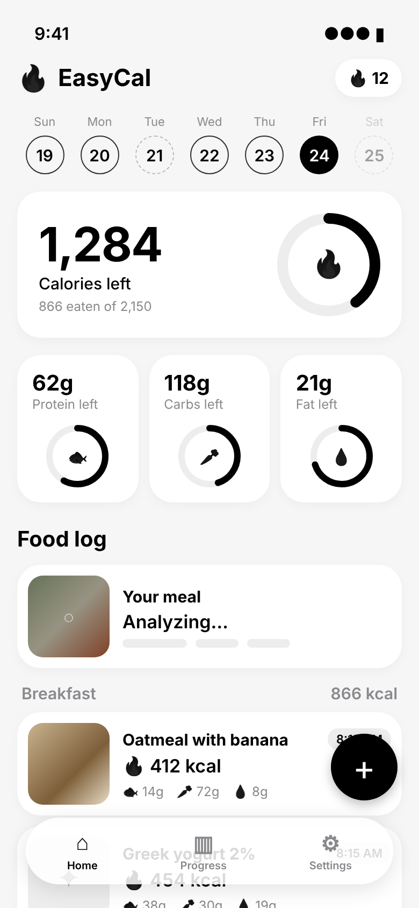
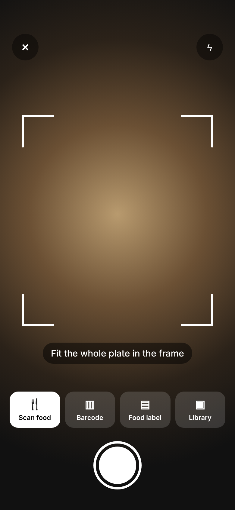
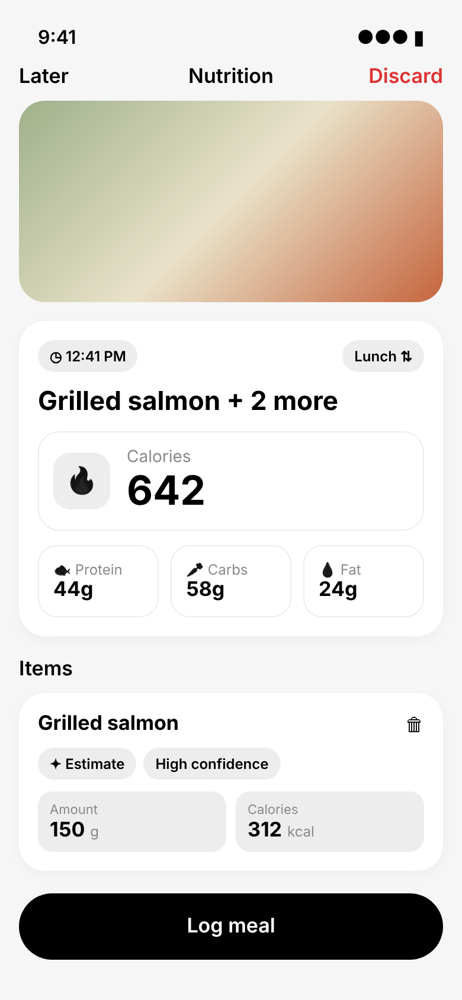
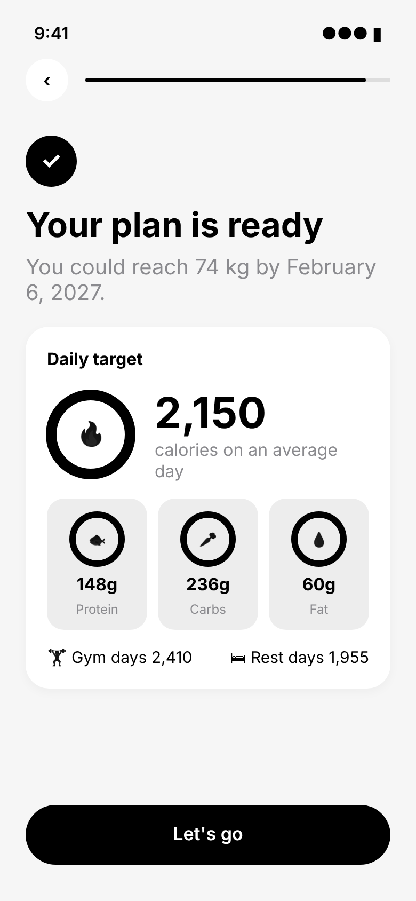

# EasyCal

No one should have to pay for yet another subscription.

Snap a photo of your meal, scan a barcode, or type what you ate, and get calories and macros. Everything the paid AI calorie apps do, but open source: just hook up your own AI.

<p>
  
  
  
  
</p>

## Bring your own AI
- Sign in with ChatGPT and use your existing plan
- Or paste a Claude, OpenAI or Gemini API key
- Or point it at any OpenAI-compatible server (OpenRouter, Ollama, LM Studio)

Keys stay in the iPhone Keychain. There's no backend and no account, and your food log never leaves the phone except for the requests you send to your own AI provider.

## Build
iOS 26+. On a Mac with Xcode:

```
brew install xcodegen
xcodegen generate
open CalorieTracker.xcodeproj
```

To install on an iPhone with a free Apple ID, see `docs/testing-on-iphone.md`.

## Status
Early. Runs on a real iPhone, and ChatGPT sign-in works. Other features are still being tested on device.
